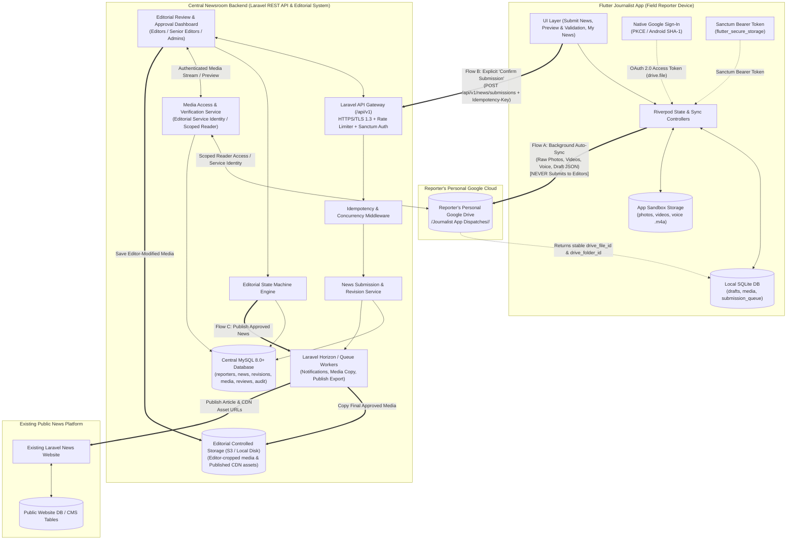
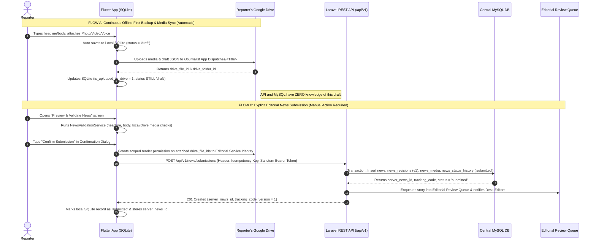

# System Architecture — Journalist App & Editorial Backend (TASK 06.1)

> **Document Status:** Approved Architecture Design (TASK 06.1 — Design-Only)  
> **Target Stack:** Flutter Mobile Client (Android/iOS) • SQLite Offline Engine • Personal Google Drive API (`drive.file`) • Laravel 11 REST API (`/api/v1`) • MySQL 8.0+ Central Database • Editorial Review Portal • Existing Laravel News Website

---

## 1. Executive Summary & Architectural Principles

The Journalist App ecosystem enables field reporters across Bangladesh to compose, record, back up, validate, and submit news dispatches under unreliable network conditions while giving newsroom editors a structured, auditable review workflow before stories go live on the public news website.

### Core Architectural Invariants
1. **Strict Separation of Concerns (Cloud Backup vs. Editorial Submission):**
   - **Google Drive Synchronization** is an automated, background **personal cloud backup and raw media hosting mechanism** controlled by the reporter's personal Google account (`drive.file` scope). It **never** triggers editorial review or creates records in the central newsroom queue on its own.
   - **Editorial News Submission** is an **explicit, intentional reporter action** (`Preview & Validate -> Confirm Submission`) that sends structured news metadata, text, and verified Google Drive media references to the **Laravel REST API** and **Central MySQL Database**.
2. **Offline-First Resilience:**
   - All authoring, photo/video attachment, and voice dispatch recording happen locally against the app-managed file system and **SQLite (`journalist_offline.db`)**.
   - Both Google Drive media uploads and Laravel API news submissions use persistent local state machines with deterministic UUIDs, idempotency keys, and exponential-backoff retry queues.
3. **Zero Shared Secrets in the Mobile Client:**
   - The Flutter app contains **no** MySQL credentials, **no** Google OAuth client secrets (uses Android SHA-1 / iOS bundle ID native PKCE OAuth flows), and **no** static administrative API keys.
4. **Immutable Auditability & Editorial Governance:**
   - Every submitted story revision, editorial modification, review comment, and status transition is immutably versioned in MySQL (`news_revisions`, `news_status_history`, `audit_logs`).
   - **Editorial Approval (`approved`)** and **Website Publication (`published`)** are decoupled states so senior editors or automated publishing pipelines control exactly when approved content goes live on the public Laravel News Website.

---

## 2. High-Level System Architecture & Data Flow

### 2.1 Mermaid System Architecture Diagram

---

### 2.2 Component Responsibilities

| Component | Primary Responsibility | Storage / State | Boundary Rule |
| :--- | :--- | :--- | :--- |
| **Flutter Journalist App** | Offline-first authoring, camera/gallery capture, native voice recording (`.m4a`), pre-submission validation, background Drive sync, explicit API submission, and tracking editorial feedback. | App documents directory + SQLite + `flutter_secure_storage` | Never connects directly to MySQL; never embeds client secrets. |
| **Local SQLite Database** | Stores working drafts (`drafts` table), media attachment states (`media_attachments`), pending API submission queue, and cached server status of submitted stories. | On-device SQLite (`journalist_offline.db`) | Remains authoritative for unsubmitted `draft` state; synchronizes server state after submission. |
| **Reporter's Personal Google Drive** | Stores the reporter's raw, full-resolution photos, videos, voice dispatches, and backup draft JSON inside `Journalist App Dispatches/<News Title>/`. | Reporter's personal Google Drive storage quota | Owned by the reporter; **never** written to by editors; **never** triggers news submission. |
| **Secure Laravel REST API (`/api/v1`)** | Authenticates reporters/editors via Laravel Sanctum, validates payloads, enforces idempotency and role-based access control (RBAC), records revisions, and exposes endpoints for mobile and editorial clients. | Stateless PHP-FPM / Octane workers backed by Redis & MySQL | Single entry point for all mobile and editorial operations. |
| **Central MySQL Database** | Single source of truth for reporter accounts, submitted news, immutable text revisions, media metadata & Drive file pointers, editorial reviews, status history, notifications, and audit logs. | MySQL 8.0+ (`InnoDB`, `utf8mb4_unicode_ci`) | Strictly enforces foreign keys, ACID transactions, and optimistic concurrency versions. |
| **Editorial Review & Approval System** | Web interface (or Filament/Laravel Nova/Blade module) where editors claim submitted stories, inspect/stream raw media from Drive via secure grants, request corrections, edit copy (creating new revisions), reject, or approve stories. | Reads/writes via Central MySQL & Editorial Controlled Storage | Editors cannot overwrite reporter's original files in Google Drive. |
| **Existing Laravel News Website** | Public-facing news portal serving readers. Receives only **approved and explicitly published** articles and website-hosted media derivatives. | Public CMS database + Website CDN / Public Storage | Completely isolated from unverified drafts, rejected stories, and personal Google Drive links. |

---

### 2.3 Separation of Data Flows: Drive Sync vs. Editorial Submission

To prevent accidental leaks of unfinished notes or raw recordings to the newsroom desk, the architecture enforces a hard wall between **Flow A (Personal Cloud Sync)** and **Flow B (Editorial Submission)**:

---

## 3. Reporter Authentication & Authorization

### 3.1 Dual-Identity Separation: App Authentication vs. Google Drive OAuth

A critical architectural requirement is decoupling **Newsroom Identity (App Authentication)** from **Personal Cloud Storage Identity (Google Drive OAuth)**:

| Dimension | 1. Newsroom App Authentication (Laravel API) | 2. Google Drive Storage Authentication (Google OAuth) |
| :--- | :--- | :--- |
| **Purpose** | Identifies the journalist or editor to the newsroom backend; authorizes API calls and editorial actions. | Authorizes the Flutter app to upload files and manage folders in the reporter's personal Google Drive. |
| **Protocol / Provider** | **Laravel Sanctum** Personal Access Tokens (issued by `/api/v1/auth/login`) with device fingerprint & expiration. | **Google Sign-In / OAuth 2.0 PKCE** via `google_sign_in` plugin on Android/iOS (`drive.file` + `email` scopes). |
| **Token Storage on Device** | Encrypted in Android Keystore / iOS Keychain via `flutter_secure_storage`. | Managed natively by Google Play Services / iOS Keychain; active email tracked in SQLite (`reporter_google_account_email`). |
| **Secrets in Flutter** | **None.** Password verified via Argon2id on Laravel server. | **None.** Uses OS-level package name + SHA-1 certificate fingerprint registered in Google Cloud Console. |
| **Account Switching Rule** | Logging out of the Newsroom App clears the active session token and stops background submission jobs. | A reporter can connect/reconnect a personal Google account (`google_account_email`). All Drive uploads record which `reporter_google_email` owns the `drive_file_id`. |

### 3.2 Why Laravel Sanctum?
**Laravel Sanctum** is selected over Passport (full OAuth2 server) or stateless JWTs for the following reasons:
1. **Instant Server-Side Revocation:** If a reporter's phone is lost or a reporter is suspended (`is_active = false`), revoking their token in MySQL (`personal_access_tokens` / `reporter_authentication`) takes effect on the very next API request—unlike stateless JWTs which remain valid until expiry.
2. **Token Abilities (Scopes) & Device Binding:** Each mobile login issues a device-bound token (e.g., `device_id`, `device_name`, abilities: `['news:submit', 'news:read', 'news:revise', 'media:grant']`) with configurable TTL (e.g., 30-day rolling expiration with 24-hour activity refresh).
3. **Lightweight & Native to Laravel:** Zero external OAuth server overhead while supporting both mobile Bearer tokens and SPA/session cookies for the web-based Editorial Portal.

### 3.3 Role-Based Access Control (RBAC) & Ownership Matrix

The system defines four strict roles stored in `reporters.role`:

| Capability / Action | `reporter` | `editor` | `senior_editor` | `admin` |
| :--- | :---: | :---: | :---: | :---: |
| Create/edit local offline drafts in Flutter | Yes (Own) | No | No | No |
| Submit news to API (`draft -> submitted`) | Yes (Own) | No | No | No |
| View submitted news & status history | Yes (Own only) | Yes (All / Assigned) | Yes (All) | Yes (All) |
| Edit submitted news while `submitted` or `under_review` | **No (Locked)** | Yes (Creates new revision) | Yes (Creates new revision) | No (Audit only) |
| Claim story for review (`submitted -> under_review`) | No | Yes | Yes | Yes |
| Request corrections (`under_review -> correction_requested`) | No | Yes | Yes | Yes |
| Revise & resubmit (`correction_requested -> resubmitted`) | Yes (Own only) | No | No | No |
| Reject story (`under_review -> rejected`) | No | Yes | Yes | Yes |
| Approve story (`under_review -> approved`) | No | Yes (If granted) | Yes | Yes |
| Publish to Live Website (`approved -> published`) | No | No | Yes | Yes |
| Suspend/unsuspend reporter or revoke tokens | No | No | No | Yes |

### 3.4 Account Suspension & Access Restrictions
- Every authenticated API request passes through custom middleware `EnsureReporterIsActive`:
  1. Verifies Sanctum token validity and expiry.
  2. Checks `reporters.status === 'active'` and `reporters.is_verified === 1`.
  3. If `status === 'suspended'` or `revoked`, the middleware immediately aborts with `403 Forbidden` (`ACCOUNT_SUSPENDED`), deletes all active Sanctum tokens for that user, and logs a security event in `audit_logs`.
- Suspended reporters can still access their local offline drafts on their phone and their personal Google Drive (since it is their personal cloud), but cannot submit new stories or access newsroom APIs.

---

## 4. Offline-First Integration & Synchronization Strategy

### 4.1 Local-to-Server ID Mapping
Because drafts and media attachments are created offline before the server knows they exist, the system uses a **Dual-Identifier Pattern**:
- **Client UUID (`client_draft_uuid` & `client_media_uuid`):** Deterministic UUIDv4 strings generated by the Flutter app when a draft or media attachment is created offline (stored in SQLite `drafts.id` and `media_attachments.id`).
- **Server Primary Key (`id`) & Public Tracking Code (`tracking_code`):** When the draft is first submitted to Laravel, MySQL generates an auto-incrementing internal `BIGINT UNSIGNED` primary key (`news.id`), stores the immutable `client_draft_uuid` (`UNIQUE`), and generates a human-readable newsroom tracking code (e.g., `NWS-20261111-0042`).
- The API response returns `{ "server_news_id": 1042, "client_draft_uuid": "...", "tracking_code": "NWS-20261111-0042", "version": 1 }`, which the Flutter app persists in local SQLite (`server_news_id`, `tracking_code`, `server_version`).

### 4.2 Pending Submission Queue & Retry Strategy
When a reporter taps **Confirm Submission**:
1. **Prerequisite Check:** All attached media items (`mediaAttachments` and `voiceDispatch`) must have `is_uploaded_to_drive == true` and a non-null `drive_file_id`.
   - *Offline Submission Queueing:* If the reporter confirms submission while offline (or while a media upload is still pending), the local draft transitions to local sub-state `queued_for_submission`.
   - As soon as connectivity returns, `DraftSyncService` first completes any pending Google Drive media uploads, grants the scoped Drive reader permission, and then automatically dispatches the queued API submission request.
2. **Exponential Backoff with Jitter:**
   - Failed API calls due to network timeouts, DNS failures, or `502/503/504` server errors are retried with exponential backoff: `delay = min(300s, 2^attempt * 3s + random(0..1000ms))`.
   - Validation errors (`422 Unprocessable Entity`) or auth errors (`401/403`) do **not** auto-retry; they transition the local submission state to `submission_failed` and surface a clear banner to the reporter.

### 4.3 Preventing Duplicate Submissions (Idempotency)
Network connections in the field frequently drop **after** the server processes a `POST` request but **before** the mobile client receives the `201 Created` HTTP response.
- Every submission or resubmission request includes an `Idempotency-Key` header derived deterministically from:
  `SHA-256(reporter_id + ":" + client_draft_uuid + ":" + local_revision_number)`
- On the Laravel backend, the `IdempotencyMiddleware` checks the `submission_idempotency_keys` table inside a database lock:
  - If the key does not exist, it creates a record (`status = 'processing'`) and runs the controller inside a DB transaction. Upon completion, it caches the exact HTTP status code and JSON response payload against that key (TTL: 72 hours).
  - If the mobile app retries with the same `Idempotency-Key` and identical payload hash, the API immediately returns the stored `200 OK / 201 Created` response **without** creating a duplicate `news` row or duplicate revision.
  - Even if an idempotency key expires after 72 hours, the `UNIQUE (client_draft_uuid)` constraint on the `news` table guarantees a second layer of protection against duplicate news creation.

### 4.4 Conflict Detection & Resolution (Optimistic Concurrency)
- Every `news` record carries an integer `version` column (incremented on every state change or revision).
- When a reporter submits a correction (`PUT /api/v1/news/{uuid}/resubmit`) or an editor saves changes (`PATCH /api/v1/editorial/news/{uuid}`), the client must send `expected_version` (or `If-Match: "v{version}"`).
- If `news.version != expected_version` (for example, two editors clicked "Claim" simultaneously, or an editor approved a story at the exact moment another requested corrections), the server rejects the request with `409 Conflict` (`VERSION_CONFLICT`) and returns the latest server state so the client can refresh.

### 4.5 Synchronizing Editorial Status Updates Back to Flutter
The Flutter app stays synchronized with newsroom actions through two complementary channels:
1. **Push Notifications (Firebase Cloud Messaging — FCM):** When a story transitions to `under_review`, `correction_requested`, `rejected`, `approved`, or `published`, a Laravel queued job writes a row to `notifications` and sends an FCM data/notification payload to the reporter's registered device token.
2. **Delta Polling / Pull-to-Refresh (`GET /api/v1/news?updated_since=<ISO8601>`):** Whenever the app opens, reconnects to the internet, or the user pulls to refresh on the "My News / Drafts" screen, the app fetches all stories modified since the last sync timestamp and updates local SQLite status badges, editorial comments, and lock states.

---

## 5. Security, Reliability & Operational Safeguards

### 5.1 Transport & API Security
- **HTTPS / TLS 1.3 Only:** All `/api/v1/*` traffic requires HTTPS. Plain HTTP requests are rejected at the Nginx/Cloudflare edge. Certificate pinning (or public key hash validation) is recommended for production APK builds.
- **Granular Rate Limiting (Laravel `RateLimiter`):**
  - `POST /api/v1/auth/login`: Max **5 attempts / minute** per IP + email combination (with temporary lockout recorded in `reporter_authentication`).
  - `POST /api/v1/news/submissions`: Max **10 submissions / minute** per authenticated `reporter_id`.
  - General authenticated read endpoints: **60 requests / minute** per user.
- **Input Validation & Sanitization:**
  - Strict Laravel `FormRequest` validation on all endpoints.
  - Headlines and incident bodies are stripped of executable HTML/script tags (`HTMLPurifier` / `strip_tags` with safe formatting whitelist) to prevent Stored XSS inside the Editorial Review Portal.

### 5.2 Database Integrity & Transactions
- Every write operation that mutates news state executes inside a single `DB::transaction(...)`:
  - Updating `news.status` + inserting `news_revisions` + inserting `news_status_history` + inserting `audit_logs` + writing `submission_idempotency_keys` succeed or roll back atomically.
- All tables use `InnoDB` with strict foreign key constraints and explicit `ON DELETE RESTRICT` on editorial/news tables so historical records cannot be orphaned.

### 5.3 Backup, Retention & Disaster Recovery
- **MySQL Point-in-Time Recovery (PITR):** Daily automated full snapshots + continuous binary log (`binlog`) shipping to off-site encrypted object storage (30-day retention).
- **Soft Deletes & Legal Hold:** Submitted `news`, `news_revisions`, and `editorial_reviews` **never** undergo hard `DELETE` via API. Rejected stories remain archived for 180 days (configurable) for editorial audit and dispute resolution.
- **Audit Log Immutability:** The `audit_logs` and `news_status_history` tables are append-only (`INSERT` only; application DB user should not execute `UPDATE` or `DELETE` on these tables).

