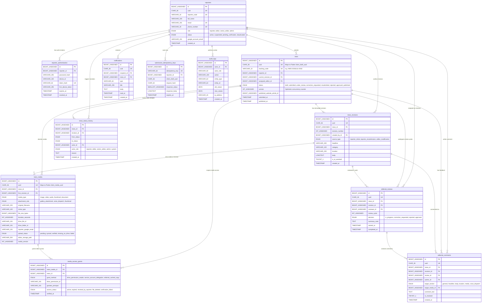

# Central MySQL Database Schema Design (TASK 06.1)

> **Document Status:** Approved Database Schema Specification (TASK 06.1 — Design-Only)  
> **Database Engine:** MySQL 8.0+ (`InnoDB`)  
> **Character Set & Collation:** `utf8mb4` / `utf8mb4_unicode_ci` (Full Bengali Unicode & Emoji Support)  
> **Time Zone Standard:** All timestamps stored in `UTC` (`TIMESTAMP` / `DATETIME`); converted to `Asia/Dhaka` (`+06:00`) at presentation layer.

---

## 1. Entity-Relationship Diagram (Mermaid)

---

## 2. Complete Table Specifications

### 2.1 Table: `reporters`
Stores all newsroom personnel (field reporters, desk editors, senior editors, and system administrators). Aligns directly with Flutter's `Reporter` model (`lib/models/reporter.dart`).

| Column Name | MySQL Data Type | Nullable | Default | Constraints & Notes |
| :--- | :--- | :--- | :--- | :--- |
| `id` | `BIGINT UNSIGNED` | `NOT NULL` | `AUTO_INCREMENT` | **PK** |
| `uuid` | `CHAR(36)` | `NOT NULL` | — | **UNIQUE** (`uk_reporters_uuid`). Stable external UUID. |
| `reporter_code` | `VARCHAR(32)` | `NOT NULL` | — | **UNIQUE** (`uk_reporters_code`). Human ID, e.g., `REP-2026-084`. |
| `full_name` | `VARCHAR(150)` | `NOT NULL` | — | Full legal/byline name (supports Bengali & English). |
| `email` | `VARCHAR(191)` | `NOT NULL` | — | **UNIQUE** (`uk_reporters_email`). Primary login email. |
| `phone_number` | `VARCHAR(30)` | `NULL` | `NULL` | **UNIQUE** (`uk_reporters_phone`). E.164 format (`+8801...`). |
| `designation` | `VARCHAR(100)` | `NOT NULL` | `'Staff Reporter'` | Job title, e.g., `Senior District Correspondent`. |
| `assigned_area` | `VARCHAR(120)` | `NULL` | `NULL` | Geographic beat/district, e.g., `Dhaka North`, `Sylhet`. |
| `profile_photo_url` | `VARCHAR(500)` | `NULL` | `NULL` | Avatar URL in website-controlled storage. |
| `role` | `ENUM('reporter','editor','senior_editor','admin')` | `NOT NULL` | `'reporter'` | Primary RBAC role. |
| `status` | `ENUM('active','suspended','pending_verification','deactivated')` | `NOT NULL` | `'pending_verification'` | Controls API access via `EnsureReporterIsActive` middleware. |
| `is_verified` | `TINYINT(1)` | `NOT NULL` | `0` | `1` once identity & press credentials are verified. |
| `google_account_email` | `VARCHAR(191)` | `NULL` | `NULL` | Currently linked personal Google Drive email reported by Flutter app. |
| `google_linked_at` | `TIMESTAMP` | `NULL` | `NULL` | When the reporter last linked/switched their Google Drive account. |
| `suspended_reason` | `VARCHAR(500)` | `NULL` | `NULL` | Populated if `status = 'suspended'`. |
| `suspended_at` | `TIMESTAMP` | `NULL` | `NULL` | Timestamp of suspension. |
| `last_active_at` | `TIMESTAMP` | `NULL` | `NULL` | Updated on authenticated API activity. |
| `created_at` | `TIMESTAMP` | `NOT NULL` | `CURRENT_TIMESTAMP` | Record creation time. |
| `updated_at` | `TIMESTAMP` | `NOT NULL` | `CURRENT_TIMESTAMP ON UPDATE CURRENT_TIMESTAMP` | Last update time. |
| `deleted_at` | `TIMESTAMP` | `NULL` | `NULL` | Soft-delete timestamp. |

- **Indexes:**
  - `PRIMARY KEY (id)`
  - `UNIQUE KEY uk_reporters_uuid (uuid)`
  - `UNIQUE KEY uk_reporters_code (reporter_code)`
  - `UNIQUE KEY uk_reporters_email (email)`
  - `UNIQUE KEY uk_reporters_phone (phone_number)`
  - `INDEX idx_reporters_role_status (role, status)`
  - `INDEX idx_reporters_google_email (google_account_email)`
- **Deletion & Retention Rule:** **Never hard-deleted** once a reporter has submitted at least one news item (`ON DELETE RESTRICT` from `news`). Soft-deleted or set to `status = 'deactivated'`.

---

### 2.2 Table: `reporter_authentication`
Stores password credentials, security lockout counters, and device-scoped API authentication sessions (works alongside or extends Laravel Sanctum's token management).

| Column Name | MySQL Data Type | Nullable | Default | Constraints & Notes |
| :--- | :--- | :--- | :--- | :--- |
| `id` | `BIGINT UNSIGNED` | `NOT NULL` | `AUTO_INCREMENT` | **PK** |
| `reporter_id` | `BIGINT UNSIGNED` | `NOT NULL` | — | **FK** -> `reporters(id)` `ON DELETE CASCADE`. |
| `password_hash` | `VARCHAR(255)` | `NOT NULL` | — | Argon2id / Bcrypt hash of the reporter's newsroom password. |
| `password_changed_at` | `TIMESTAMP` | `NULL` | `NULL` | Tracks password rotation. |
| `token_name` | `VARCHAR(100)` | `NULL` | `NULL` | E.g., `flutter_android_pixel7`. |
| `token_hash` | `CHAR(64)` | `NULL` | `NULL` | **UNIQUE** (`uk_rep_auth_token_hash`). SHA-256 hash of Sanctum plain-text token. |
| `abilities` | `JSON` | `NULL` | `NULL` | Token scopes, e.g., `["news:submit","news:read","media:grant"]`. |
| `device_id` | `VARCHAR(100)` | `NULL` | `NULL` | Hardware/installation UUID from Flutter client. |
| `device_name` | `VARCHAR(150)` | `NULL` | `NULL` | OS and model string for security audit. |
| `fcm_device_token` | `VARCHAR(255)` | `NULL` | `NULL` | Firebase Cloud Messaging registration token for push notifications. |
| `bound_google_email` | `VARCHAR(191)` | `NULL` | `NULL` | Snapshot of the Google Drive account active on this device session. |
| `failed_login_attempts` | `SMALLINT UNSIGNED` | `NOT NULL` | `0` | Incremented on bad password; reset on success. |
| `locked_until` | `TIMESTAMP` | `NULL` | `NULL` | Temporary brute-force lockout expiration. |
| `last_used_at` | `TIMESTAMP` | `NULL` | `NULL` | Last API call using this session. |
| `last_ip_address` | `VARCHAR(45)` | `NULL` | `NULL` | IPv4 or IPv6 address. |
| `expires_at` | `TIMESTAMP` | `NULL` | `NULL` | Token expiration timestamp. |
| `revoked_at` | `TIMESTAMP` | `NULL` | `NULL` | Non-null when logged out or force-revoked by admin. |
| `created_at` | `TIMESTAMP` | `NOT NULL` | `CURRENT_TIMESTAMP` | Session creation timestamp. |
| `updated_at` | `TIMESTAMP` | `NOT NULL` | `CURRENT_TIMESTAMP ON UPDATE CURRENT_TIMESTAMP` | Last update timestamp. |

- **Indexes:**
  - `PRIMARY KEY (id)`
  - `UNIQUE KEY uk_rep_auth_token_hash (token_hash)`
  - `INDEX idx_rep_auth_reporter_active (reporter_id, revoked_at, expires_at)`
  - `INDEX idx_rep_auth_device (reporter_id, device_id)`
- **Deletion & Retention Rule:** Revoked/expired token rows are retained for 90 days for security auditing, then purged by a scheduled cleanup command.

---

### 2.3 Table: `news`
The master editorial record for each submitted news story. Maps 1-to-1 with a Flutter offline draft via `uuid` (`client_draft_uuid`).

| Column Name | MySQL Data Type | Nullable | Default | Constraints & Notes |
| :--- | :--- | :--- | :--- | :--- |
| `id` | `BIGINT UNSIGNED` | `NOT NULL` | `AUTO_INCREMENT` | **PK** |
| `uuid` | `CHAR(36)` | `NOT NULL` | — | **UNIQUE** (`uk_news_uuid`). Matches Flutter `NewsDraft.id` (`client_draft_uuid`). |
| `tracking_code` | `VARCHAR(32)` | `NOT NULL` | — | **UNIQUE** (`uk_news_tracking_code`). E.g., `NWS-20261111-0042`. |
| `reporter_id` | `BIGINT UNSIGNED` | `NOT NULL` | — | **FK** -> `reporters(id)` `ON DELETE RESTRICT`. Owning reporter. |
| `current_revision_id` | `BIGINT UNSIGNED` | `NULL` | `NULL` | **FK** -> `news_revisions(id)` `ON DELETE SET NULL`. Points to active text revision. |
| `assigned_editor_id` | `BIGINT UNSIGNED` | `NULL` | `NULL` | **FK** -> `reporters(id)` `ON DELETE SET NULL`. Editor currently reviewing. |
| `approved_by_id` | `BIGINT UNSIGNED` | `NULL` | `NULL` | **FK** -> `reporters(id)` `ON DELETE SET NULL`. Editor who approved. |
| `published_by_id` | `BIGINT UNSIGNED` | `NULL` | `NULL` | **FK** -> `reporters(id)` `ON DELETE SET NULL`. Senior editor who published. |
| `status` | `ENUM('draft','submitted','under_review','correction_requested','resubmitted','rejected','approved','published')` | `NOT NULL` | `'submitted'` | Current editorial workflow state. |
| `priority` | `ENUM('low','normal','high','breaking')` | `NOT NULL` | `'normal'` | Editorial triage priority. |
| `is_locked_for_reporter` | `TINYINT(1)` | `NOT NULL` | `1` | `1` when status is anything other than `correction_requested` (or local `draft`). |
| `version` | `INT UNSIGNED` | `NOT NULL` | `1` | Optimistic concurrency version; incremented on every mutation. |
| `drive_folder_id` | `VARCHAR(191)` | `NULL` | `NULL` | Google Drive folder ID (`Journalist App Dispatches/<News Title>`). |
| `drive_draft_json_file_id` | `VARCHAR(191)` | `NULL` | `NULL` | Google Drive file ID of the backup JSON metadata file. |
| `reporter_google_email` | `VARCHAR(191)` | `NULL` | `NULL` | Google account email that owns the Drive folder at submission time. |
| `published_website_article_id` | `BIGINT UNSIGNED` | `NULL` | `NULL` | Reference ID in the existing public Laravel News Website database. |
| `published_website_url` | `VARCHAR(500)` | `NULL` | `NULL` | Public URL once published on the news website. |
| `client_created_at` | `TIMESTAMP` | `NULL` | `NULL` | When the draft was first created offline on the reporter's phone. |
| `submitted_at` | `TIMESTAMP` | `NOT NULL` | `CURRENT_TIMESTAMP` | Initial submission timestamp. |
| `last_resubmitted_at` | `TIMESTAMP` | `NULL` | `NULL` | Most recent resubmission timestamp after correction request. |
| `review_started_at` | `TIMESTAMP` | `NULL` | `NULL` | When an editor claimed the story (`under_review`). |
| `approved_at` | `TIMESTAMP` | `NULL` | `NULL` | When editorial approval was granted. |
| `published_at` | `TIMESTAMP` | `NULL` | `NULL` | When exported/published to the live website. |
| `rejected_at` | `TIMESTAMP` | `NULL` | `NULL` | When rejected. |
| `created_at` | `TIMESTAMP` | `NOT NULL` | `CURRENT_TIMESTAMP` | Server record creation timestamp. |
| `updated_at` | `TIMESTAMP` | `NOT NULL` | `CURRENT_TIMESTAMP ON UPDATE CURRENT_TIMESTAMP` | Last update timestamp. |
| `deleted_at` | `TIMESTAMP` | `NULL` | `NULL` | Soft delete (admin archive only). |

- **Indexes:**
  - `PRIMARY KEY (id)`
  - `UNIQUE KEY uk_news_uuid (uuid)`
  - `UNIQUE KEY uk_news_tracking_code (tracking_code)`
  - `INDEX idx_news_reporter_status (reporter_id, status, updated_at)`
  - `INDEX idx_news_editorial_queue (status, priority, submitted_at)`
  - `INDEX idx_news_assigned_editor (assigned_editor_id, status)`
  - `INDEX idx_news_published_article (published_website_article_id)`
- **Deletion & Retention Rule:** **Never hard-deleted.** Soft-deleted only by `admin` under legal/compliance hold. All child revisions and status history are preserved permanently.

---

### 2.4 Table: `news_revisions`
Stores **immutable** snapshots of the news content (`headline`, `category`, `location`, `body`, AI metadata) every time a reporter submits, an editor modifies text, or a reporter resubmits after a correction request.

| Column Name | MySQL Data Type | Nullable | Default | Constraints & Notes |
| :--- | :--- | :--- | :--- | :--- |
| `id` | `BIGINT UNSIGNED` | `NOT NULL` | `AUTO_INCREMENT` | **PK** |
| `uuid` | `CHAR(36)` | `NOT NULL` | — | **UNIQUE** (`uk_news_revisions_uuid`). |
| `news_id` | `BIGINT UNSIGNED` | `NOT NULL` | — | **FK** -> `news(id)` `ON DELETE RESTRICT`. |
| `revision_number` | `INT UNSIGNED` | `NOT NULL` | — | Sequential (`1, 2, 3...`) per `news_id`. |
| `created_by_id` | `BIGINT UNSIGNED` | `NOT NULL` | — | **FK** -> `reporters(id)` `ON DELETE RESTRICT`. Who created this revision. |
| `created_by_role` | `ENUM('reporter','editor','senior_editor','admin')` | `NOT NULL` | — | Role of the author at the moment of creation. |
| `source_type` | `ENUM('reporter_initial','reporter_resubmission','editor_modification')` | `NOT NULL` | `'reporter_initial'` | Origin of this revision snapshot. |
| `headline` | `VARCHAR(300)` | `NOT NULL` | — | Validated headline text at this revision. |
| `category` | `VARCHAR(100)` | `NOT NULL` | `'General'` | News category (e.g., `National`, `Politics`, `Sports`, `Crime`). |
| `location` | `VARCHAR(200)` | `NULL` | `NULL` | Dateline / incident location (e.g., `Mirpur, Dhaka`). |
| `body` | `LONGTEXT` | `NOT NULL` | — | Complete news body / incident details. |
| `ai_assisted_headline` | `VARCHAR(300)` | `NULL` | `NULL` | Preserves `NewsDraft.aiAssistedHeadline` if AI polish was used. |
| `ai_assisted_body` | `LONGTEXT` | `NULL` | `NULL` | Preserves `NewsDraft.aiAssistedBody` if AI polish was used. |
| `is_ai_assisted` | `TINYINT(1)` | `NOT NULL` | `0` | `1` if AI assistance was used in drafting. |
| `change_summary` | `VARCHAR(500)` | `NULL` | `NULL` | Note explaining what changed in this revision. |
| `content_sha256` | `CHAR(64)` | `NOT NULL` | — | SHA-256 hash of `headline + category + location + body` for integrity verification. |
| `created_at` | `TIMESTAMP` | `NOT NULL` | `CURRENT_TIMESTAMP` | Immutable creation timestamp (no `updated_at` — rows are never mutated). |

- **Indexes:**
  - `PRIMARY KEY (id)`
  - `UNIQUE KEY uk_news_revisions_uuid (uuid)`
  - `UNIQUE KEY uk_news_id_revision_num (news_id, revision_number)`
  - `INDEX idx_news_revisions_author (created_by_id, created_at)`
- **Deletion & Retention Rule:** **Append-only / Immutable.** `UPDATE` and `DELETE` are forbidden on `news_revisions`.

---

### 2.5 Table: `news_media`
Stores metadata and Google Drive pointers for all attached photos, videos, and voice dispatches. Aligns with Flutter's `NewsMedia` model (`lib/models/news_media.dart`).

| Column Name | MySQL Data Type | Nullable | Default | Constraints & Notes |
| :--- | :--- | :--- | :--- | :--- |
| `id` | `BIGINT UNSIGNED` | `NOT NULL` | `AUTO_INCREMENT` | **PK** |
| `uuid` | `CHAR(36)` | `NOT NULL` | — | **UNIQUE** (`uk_news_media_uuid`). Matches Flutter `NewsMedia.id` (`client_media_uuid`). |
| `news_id` | `BIGINT UNSIGNED` | `NOT NULL` | — | **FK** -> `news(id)` `ON DELETE RESTRICT`. |
| `first_revision_id` | `BIGINT UNSIGNED` | `NOT NULL` | — | **FK** -> `news_revisions(id)` `ON DELETE RESTRICT`. Revision that introduced this file. |
| `removed_in_revision_id` | `BIGINT UNSIGNED` | `NULL` | `NULL` | **FK** -> `news_revisions(id)` `ON DELETE SET NULL`. Non-null if replaced/removed in a later resubmission. |
| `media_type` | `ENUM('image','video','audio','thumbnail','document')` | `NOT NULL` | — | Matches Flutter `MediaType`. |
| `attachment_role` | `ENUM('gallery_attachment','voice_dispatch','thumbnail')` | `NOT NULL` | `'gallery_attachment'` | Distinguishes the primary voice recording (`voiceDispatch`) from gallery photos/videos. |
| `display_order` | `SMALLINT UNSIGNED` | `NOT NULL` | `0` | Ordering inside the story gallery. |
| `original_filename` | `VARCHAR(255)` | `NOT NULL` | — | Original filename from reporter device. |
| `mime_type` | `VARCHAR(100)` | `NOT NULL` | — | E.g., `image/jpeg`, `video/mp4`, `audio/mp4`. |
| `file_size_bytes` | `BIGINT UNSIGNED` | `NOT NULL` | — | Validated file size in bytes (Photos <= 25MB, Video <= 100MB, Audio <= 25MB). |
| `duration_seconds` | `INT UNSIGNED` | `NULL` | `NULL` | Duration for `video` and `audio` (Voice max 900s / 15m). |
| `checksum_sha256` | `CHAR(64)` | `NULL` | `NULL` | Optional client-computed SHA-256 of the raw file for tamper detection. |
| `drive_file_id` | `VARCHAR(191)` | `NOT NULL` | — | Google Drive File ID in reporter's personal Drive. |
| `drive_folder_id` | `VARCHAR(191)` | `NULL` | `NULL` | Parent Google Drive Folder ID. |
| `drive_web_view_link` | `VARCHAR(500)` | `NULL` | `NULL` | Google Drive webViewLink metadata. |
| `drive_download_link` | `VARCHAR(500)` | `NULL` | `NULL` | Google Drive webContentLink metadata. |
| `reporter_google_email` | `VARCHAR(191)` | `NOT NULL` | — | Google account email that owns this `drive_file_id`. |
| `upload_status` | `ENUM('pending','synced','verified','missing_on_drive','access_denied','failed')` | `NOT NULL` | `'synced'` | Tracks Drive sync & backend verification state. |
| `editor_storage_disk` | `VARCHAR(50)` | `NULL` | `NULL` | E.g., `s3_editorial` or `public_cdn` if editor-modified or published copy exists. |
| `editor_storage_path` | `VARCHAR(500)` | `NULL` | `NULL` | Website-controlled path for editor-cropped/watermarked/published derivative. |
| `editor_modified_by_id` | `BIGINT UNSIGNED` | `NULL` | `NULL` | **FK** -> `reporters(id)` `ON DELETE SET NULL`. Editor who uploaded derivative. |
| `media_version` | `INT UNSIGNED` | `NOT NULL` | `1` | Incremented if metadata or editorial derivative is updated. |
| `captured_at` | `TIMESTAMP` | `NULL` | `NULL` | Matches `NewsMedia.createdAt` on the device. |
| `created_at` | `TIMESTAMP` | `NOT NULL` | `CURRENT_TIMESTAMP` | Server record creation timestamp. |
| `updated_at` | `TIMESTAMP` | `NOT NULL` | `CURRENT_TIMESTAMP ON UPDATE CURRENT_TIMESTAMP` | Last update timestamp. |

- **Indexes:**
  - `PRIMARY KEY (id)`
  - `UNIQUE KEY uk_news_media_uuid (uuid)`
  - `UNIQUE KEY uk_news_drive_file (news_id, drive_file_id)`
  - `INDEX idx_news_media_news_active (news_id, removed_in_revision_id, display_order)`
  - `INDEX idx_news_media_drive_id (drive_file_id)`
- **Deletion & Retention Rule:** Never hard-deleted. If a reporter replaces an attachment during `correction_requested`, `removed_in_revision_id` is populated so historical revisions remain complete.

---

### 2.6 Table: `media_access_grants`
Tracks how the newsroom backend and authorized editors are granted read access to each private file in the reporter's personal Google Drive, and logs verification health.

| Column Name | MySQL Data Type | Nullable | Default | Constraints & Notes |
| :--- | :--- | :--- | :--- | :--- |
| `id` | `BIGINT UNSIGNED` | `NOT NULL` | `AUTO_INCREMENT` | **PK** |
| `news_media_id` | `BIGINT UNSIGNED` | `NOT NULL` | — | **FK** -> `news_media(id)` `ON DELETE CASCADE`. |
| `news_id` | `BIGINT UNSIGNED` | `NOT NULL` | — | **FK** -> `news(id)` `ON DELETE CASCADE`. |
| `grant_method` | `ENUM('drive_permission_reader','delegated_token_proxy','editorial_cached_copy')` | `NOT NULL` | `'drive_permission_reader'` | Mechanism used to grant editorial access. |
| `drive_permission_id` | `VARCHAR(191)` | `NULL` | `NULL` | Google Drive Permission ID returned when granting `reader` role to the Editorial Service Identity. |
| `grantee_principal` | `VARCHAR(191)` | `NOT NULL` | — | E.g., `editorial-vault@newsdesk.project.iam.gserviceaccount.com`. |
| `access_status` | `ENUM('active','pending_verification','revoked_by_reporter','file_deleted','account_mismatch','expired')` | `NOT NULL` | `'pending_verification'` | Current readability status of the Drive file. |
| `last_verified_at` | `TIMESTAMP` | `NULL` | `NULL` | When the backend last confirmed `files.get` metadata/stream access on Drive. |
| `last_error_code` | `VARCHAR(64)` | `NULL` | `NULL` | E.g., `404_NOT_FOUND`, `403_INSUFFICIENT_PERMISSIONS`. |
| `last_error_message` | `VARCHAR(500)` | `NULL` | `NULL` | Diagnostic details if Drive verification fails. |
| `expires_at` | `TIMESTAMP` | `NULL` | `NULL` | Optional expiration for temporary cached copies. |
| `created_at` | `TIMESTAMP` | `NOT NULL` | `CURRENT_TIMESTAMP` | Record creation time. |
| `updated_at` | `TIMESTAMP` | `NOT NULL` | `CURRENT_TIMESTAMP ON UPDATE CURRENT_TIMESTAMP` | Last update time. |

- **Indexes:**
  - `PRIMARY KEY (id)`
  - `INDEX idx_media_grants_media_status (news_media_id, access_status)`
  - `INDEX idx_media_grants_news (news_id, access_status)`

---

### 2.7 Table: `editorial_reviews`
Represents a structured review session/cycle performed by an editor on a specific `news_revision`.

| Column Name | MySQL Data Type | Nullable | Default | Constraints & Notes |
| :--- | :--- | :--- | :--- | :--- |
| `id` | `BIGINT UNSIGNED` | `NOT NULL` | `AUTO_INCREMENT` | **PK** |
| `uuid` | `CHAR(36)` | `NOT NULL` | — | **UNIQUE** (`uk_editorial_reviews_uuid`). |
| `news_id` | `BIGINT UNSIGNED` | `NOT NULL` | — | **FK** -> `news(id)` `ON DELETE RESTRICT`. |
| `revision_id` | `BIGINT UNSIGNED` | `NOT NULL` | — | **FK** -> `news_revisions(id)` `ON DELETE RESTRICT`. Revision being evaluated. |
| `reviewer_id` | `BIGINT UNSIGNED` | `NOT NULL` | — | **FK** -> `reporters(id)` `ON DELETE RESTRICT`. Editor performing review. |
| `review_cycle` | `INT UNSIGNED` | `NOT NULL` | `1` | `1` for initial review, `2` after first resubmission, etc. |
| `decision` | `ENUM('in_progress','correction_requested','rejected','approved')` | `NOT NULL` | `'in_progress'` | Outcome of this review cycle. |
| `summary_note` | `TEXT` | `NULL` | `NULL` | Overall editorial verdict / instructions to the reporter. |
| `checklist_json` | `JSON` | `NULL` | `NULL` | Optional structured verification flags (`{"fact_checked":true,"media_verified":true}`). |
| `started_at` | `TIMESTAMP` | `NOT NULL` | `CURRENT_TIMESTAMP` | When editor claimed/opened review. |
| `completed_at` | `TIMESTAMP` | `NULL` | `NULL` | When decision (`correction_requested`/`rejected`/`approved`) was recorded. |
| `created_at` | `TIMESTAMP` | `NOT NULL` | `CURRENT_TIMESTAMP` | Creation timestamp. |
| `updated_at` | `TIMESTAMP` | `NOT NULL` | `CURRENT_TIMESTAMP ON UPDATE CURRENT_TIMESTAMP` | Update timestamp. |

- **Indexes:**
  - `PRIMARY KEY (id)`
  - `UNIQUE KEY uk_editorial_reviews_uuid (uuid)`
  - `INDEX idx_editorial_reviews_news_cycle (news_id, review_cycle)`
  - `INDEX idx_editorial_reviews_reviewer (reviewer_id, decision)`

---

### 2.8 Table: `editorial_comments`
Granular feedback notes or correction instructions attached to a news story, a specific section (`headline`, `body`, `media`, `voice_dispatch`), or a specific media attachment.

| Column Name | MySQL Data Type | Nullable | Default | Constraints & Notes |
| :--- | :--- | :--- | :--- | :--- |
| `id` | `BIGINT UNSIGNED` | `NOT NULL` | `AUTO_INCREMENT` | **PK** |
| `uuid` | `CHAR(36)` | `NOT NULL` | — | **UNIQUE** (`uk_editorial_comments_uuid`). |
| `news_id` | `BIGINT UNSIGNED` | `NOT NULL` | — | **FK** -> `news(id)` `ON DELETE RESTRICT`. |
| `revision_id` | `BIGINT UNSIGNED` | `NOT NULL` | — | **FK** -> `news_revisions(id)` `ON DELETE RESTRICT`. |
| `review_id` | `BIGINT UNSIGNED` | `NULL` | `NULL` | **FK** -> `editorial_reviews(id)` `ON DELETE SET NULL`. |
| `author_id` | `BIGINT UNSIGNED` | `NOT NULL` | — | **FK** -> `reporters(id)` `ON DELETE RESTRICT`. Editor or replying reporter. |
| `target_section` | `ENUM('general','headline','body','category','location','media','voice_dispatch')` | `NOT NULL` | `'general'` | Field highlighted for correction. |
| `target_media_id` | `BIGINT UNSIGNED` | `NULL` | `NULL` | **FK** -> `news_media(id)` `ON DELETE SET NULL`. Specific photo/video/audio if applicable. |
| `visibility` | `ENUM('reporter_visible','internal_editors_only')` | `NOT NULL` | `'reporter_visible'` | Allows private desk notes vs. reporter-facing correction items. |
| `comment_text` | `TEXT` | `NOT NULL` | — | Detailed comment or requested fix. |
| `is_resolved` | `TINYINT(1)` | `NOT NULL` | `0` | `1` once addressed in a subsequent revision. |
| `resolved_by_id` | `BIGINT UNSIGNED` | `NULL` | `NULL` | **FK** -> `reporters(id)` `ON DELETE SET NULL`. |
| `resolved_at` | `TIMESTAMP` | `NULL` | `NULL` | When marked resolved. |
| `created_at` | `TIMESTAMP` | `NOT NULL` | `CURRENT_TIMESTAMP` | Creation timestamp. |
| `updated_at` | `TIMESTAMP` | `NOT NULL` | `CURRENT_TIMESTAMP ON UPDATE CURRENT_TIMESTAMP` | Update timestamp. |

- **Indexes:**
  - `PRIMARY KEY (id)`
  - `UNIQUE KEY uk_editorial_comments_uuid (uuid)`
  - `INDEX idx_editorial_comments_news_vis (news_id, visibility, is_resolved)`

---

### 2.9 Table: `news_status_history`
Immutable state-transition ledger recording every status change in the lifecycle of a news item.

| Column Name | MySQL Data Type | Nullable | Default | Constraints & Notes |
| :--- | :--- | :--- | :--- | :--- |
| `id` | `BIGINT UNSIGNED` | `NOT NULL` | `AUTO_INCREMENT` | **PK** |
| `news_id` | `BIGINT UNSIGNED` | `NOT NULL` | — | **FK** -> `news(id)` `ON DELETE RESTRICT`. |
| `revision_id` | `BIGINT UNSIGNED` | `NULL` | `NULL` | **FK** -> `news_revisions(id)` `ON DELETE RESTRICT`. Active revision at transition. |
| `from_status` | `ENUM('draft','submitted','under_review','correction_requested','resubmitted','rejected','approved','published')` | `NULL` | `NULL` | `NULL` or `'draft'` on initial submission. |
| `to_status` | `ENUM('draft','submitted','under_review','correction_requested','resubmitted','rejected','approved','published')` | `NOT NULL` | — | New status entered. |
| `actor_id` | `BIGINT UNSIGNED` | `NOT NULL` | — | **FK** -> `reporters(id)` `ON DELETE RESTRICT`. User who triggered transition. |
| `actor_role` | `ENUM('reporter','editor','senior_editor','admin','system')` | `NOT NULL` | — | Role of actor at transition time. |
| `reason` | `TEXT` | `NULL` | `NULL` | Required for `correction_requested` and `rejected`; optional for others. |
| `metadata_json` | `JSON` | `NULL` | `NULL` | Extra context (e.g., `{"website_article_id": 8821}`). |
| `created_at` | `TIMESTAMP` | `NOT NULL` | `CURRENT_TIMESTAMP` | Exact transition timestamp (immutable). |

- **Indexes:**
  - `PRIMARY KEY (id)`
  - `INDEX idx_status_history_news_time (news_id, created_at)`
  - `INDEX idx_status_history_actor (actor_id, created_at)`
- **Deletion & Retention Rule:** **Append-only / Immutable.** Rows are never updated or deleted.

---

### 2.10 Table: `notifications`
Stores in-app and push notifications delivered to reporters (e.g., story under review, correction requested, approved, published) and editors (new breaking submission).

| Column Name | MySQL Data Type | Nullable | Default | Constraints & Notes |
| :--- | :--- | :--- | :--- | :--- |
| `id` | `BIGINT UNSIGNED` | `NOT NULL` | `AUTO_INCREMENT` | **PK** |
| `uuid` | `CHAR(36)` | `NOT NULL` | — | **UNIQUE** (`uk_notifications_uuid`). |
| `recipient_id` | `BIGINT UNSIGNED` | `NOT NULL` | — | **FK** -> `reporters(id)` `ON DELETE CASCADE`. |
| `news_id` | `BIGINT UNSIGNED` | `NULL` | `NULL` | **FK** -> `news(id)` `ON DELETE CASCADE`. Associated news item. |
| `type` | `VARCHAR(64)` | `NOT NULL` | — | E.g., `news.status_changed`, `news.correction_requested`, `news.published`. |
| `title` | `VARCHAR(255)` | `NOT NULL` | — | Short notification heading. |
| `body` | `TEXT` | `NOT NULL` | — | Notification message body. |
| `data_json` | `JSON` | `NULL` | `NULL` | Deep-link payload (`{"news_uuid":"...","status":"correction_requested"}`). |
| `push_status` | `ENUM('pending','sent','failed','skipped')` | `NOT NULL` | `'pending'` | FCM push delivery status. |
| `read_at` | `TIMESTAMP` | `NULL` | `NULL` | Null until recipient opens/marks read in app. |
| `created_at` | `TIMESTAMP` | `NOT NULL` | `CURRENT_TIMESTAMP` | Creation timestamp. |

- **Indexes:**
  - `PRIMARY KEY (id)`
  - `UNIQUE KEY uk_notifications_uuid (uuid)`
  - `INDEX idx_notifications_recipient_unread (recipient_id, read_at, created_at)`

---

### 2.11 Table: `submission_idempotency_keys`
Prevents duplicate news submissions or duplicate resubmissions when mobile clients retry requests over unstable networks.

| Column Name | MySQL Data Type | Nullable | Default | Constraints & Notes |
| :--- | :--- | :--- | :--- | :--- |
| `id` | `BIGINT UNSIGNED` | `NOT NULL` | `AUTO_INCREMENT` | **PK** |
| `idempotency_key` | `VARCHAR(64)` | `NOT NULL` | — | **UNIQUE** (`uk_idempotency_key`). Client-supplied `Idempotency-Key` header. |
| `reporter_id` | `BIGINT UNSIGNED` | `NOT NULL` | — | **FK** -> `reporters(id)` `ON DELETE CASCADE`. |
| `client_draft_uuid` | `CHAR(36)` | `NOT NULL` | — | UUID of the draft being submitted/resubmitted. |
| `endpoint` | `VARCHAR(191)` | `NOT NULL` | — | E.g., `POST /api/v1/news/submissions`. |
| `request_hash` | `CHAR(64)` | `NOT NULL` | — | SHA-256 hash of canonical request body to detect payload mismatch on same key. |
| `lock_status` | `ENUM('processing','completed','failed')` | `NOT NULL` | `'processing'` | Prevents concurrent in-flight execution of identical requests. |
| `response_status` | `SMALLINT UNSIGNED` | `NULL` | `NULL` | Cached HTTP status code (e.g., `201`, `200`, `422`). |
| `response_body` | `LONGTEXT` | `NULL` | `NULL` | Cached JSON response body returned to replayed requests. |
| `created_at` | `TIMESTAMP` | `NOT NULL` | `CURRENT_TIMESTAMP` | First request arrival time. |
| `expires_at` | `TIMESTAMP` | `NOT NULL` | — | Default `created_at + INTERVAL 72 HOUR`. |

- **Indexes:**
  - `PRIMARY KEY (id)`
  - `UNIQUE KEY uk_idempotency_key (idempotency_key)`
  - `INDEX idx_idempotency_expiry (expires_at)`
- **Deletion & Retention Rule:** Scheduled daily job deletes rows where `expires_at < NOW()`.

---

### 2.12 Table: `audit_logs`
Comprehensive, immutable security and operational audit trail across authentication, role changes, editorial modifications, media access, and publication.

| Column Name | MySQL Data Type | Nullable | Default | Constraints & Notes |
| :--- | :--- | :--- | :--- | :--- |
| `id` | `BIGINT UNSIGNED` | `NOT NULL` | `AUTO_INCREMENT` | **PK** |
| `actor_id` | `BIGINT UNSIGNED` | `NULL` | `NULL` | **FK** -> `reporters(id)` `ON DELETE SET NULL`. Null for unauthenticated failed login attempts. |
| `actor_role` | `VARCHAR(50)` | `NULL` | `NULL` | Snapshot of actor role. |
| `action` | `VARCHAR(100)` | `NOT NULL` | — | E.g., `auth.login_success`, `news.submitted`, `news.editor_modified`, `media.streamed`, `reporter.suspended`. |
| `entity_type` | `VARCHAR(64)` | `NOT NULL` | — | E.g., `news`, `news_media`, `reporter`, `editorial_review`. |
| `entity_id` | `VARCHAR(64)` | `NOT NULL` | — | UUID or ID of the affected record. |
| `old_values` | `JSON` | `NULL` | `NULL` | Previous state snapshot (redacting passwords/tokens). |
| `new_values` | `JSON` | `NULL` | `NULL` | New state snapshot. |
| `ip_address` | `VARCHAR(45)` | `NULL` | `NULL` | Client IP address. |
| `user_agent` | `VARCHAR(500)` | `NULL` | `NULL` | HTTP User-Agent / Flutter app version header. |
| `created_at` | `TIMESTAMP` | `NOT NULL` | `CURRENT_TIMESTAMP` | Immutable timestamp. |

- **Indexes:**
  - `PRIMARY KEY (id)`
  - `INDEX idx_audit_entity (entity_type, entity_id, created_at)`
  - `INDEX idx_audit_actor_time (actor_id, created_at)`
  - `INDEX idx_audit_action_time (action, created_at)`
- **Deletion & Retention Rule:** **Append-only.** Retained in hot MySQL storage for 1 year, then archived to cold storage.

