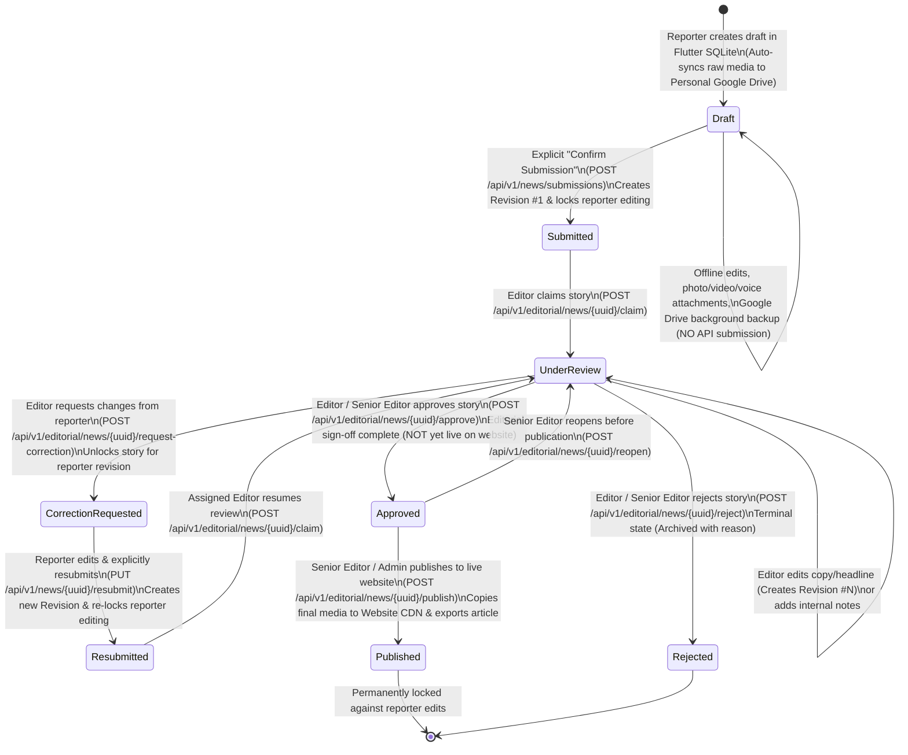

# News Submission & Editorial Workflow Specification (TASK 06.1)

> **Document Status:** Approved Workflow & State Machine Design (TASK 06.1 — Design-Only)  
> **Scope:** End-to-end lifecycle from Offline Local Draft in Flutter through Editorial Review to Public Website Publication.

---

## 1. Editorial Workflow State Machine

### 1.1 State Diagram (Mermaid)

---

### 1.2 State Definitions & Locking Semantics

| State (`news.status`) | Where It Lives | Can Owning Reporter Edit? | Can Editor Edit Content? | Publicly Visible on Website? | Description |
| :--- | :--- | :---: | :---: | :---: | :--- |
| **`draft`** | Local SQLite + Reporter's Google Drive only | **Yes (Freely)** | No (Not on server) | No | Working draft on the reporter's phone. Google Drive sync backs up files here without notifying editors. |
| **`submitted`** | Central MySQL + Local SQLite (read-only mirror) | **No (Locked)** | No (Must transition to `under_review` first) | No | Explicitly submitted by reporter; waiting in the Editorial Review Queue (`Revision #1`). |
| **`under_review`** | Central MySQL + Local SQLite status mirror | **No (Locked)** | **Yes** (Creates new `editor_modification` revision) | No | Claimed by a specific editor who is verifying facts, checking Drive media, or polishing copy. |
| **`correction_requested`** | Central MySQL + Local SQLite (unlocked for revision) | **Yes (Unlocked for Correction)** | No (Waiting on reporter) | No | Editor returned the story with mandatory feedback in `editorial_comments`. Reporter can edit text/attachments and resubmit. |
| **`resubmitted`** | Central MySQL + Local SQLite (read-only mirror) | **No (Locked)** | No (Must claim into `under_review`) | No | Reporter addressed requested corrections and submitted a new `reporter_resubmission` revision. |
| **`rejected`** | Central MySQL + Local SQLite status mirror | **No (Permanently Locked)** | No | No | Story failed verification or editorial standards. Reason recorded in `news_status_history`. |
| **`approved`** | Central MySQL + Local SQLite status mirror | **No (Permanently Locked)** | No (Unless reopened to `under_review` by Senior Editor) | **No (Staged)** | Editorial verification and copy editing are complete. Ready for scheduled or immediate publication. |
| **`published`** | Central MySQL + Public Laravel News Website | **No (Permanently Locked)** | No (Post-publication updates happen in CMS / new revision audit) | **Yes (Live)** | Approved story and website-hosted media derivatives have been exported to the live Laravel News Website. |

---

### 1.3 State Transition & Role Permission Matrix

Every transition requires a valid Sanctum token, passes through `EditorialWorkflowService`, increments `news.version`, and writes an immutable entry to `news_status_history` and `audit_logs`.

| Transition # | From State | To State | Action Name | Allowed Roles | Ownership / Guard Conditions | Creates New `news_revisions` Row? |
| :--- | :--- | :--- | :--- | :--- | :--- | :--- |
| **T1** | `draft` *(local)* | `submitted` | Submit News | `reporter` | Must be owning reporter; headline & body valid; all attached media uploaded to Drive with valid `drive_file_id` and reader grant. | **Yes** (`Revision #1`, `reporter_initial`) |
| **T2** | `submitted` | `under_review` | Claim for Review | `editor`, `senior_editor`, `admin` | Sets `assigned_editor_id` to actor; creates `editorial_reviews` row (`decision = 'in_progress'`). | No |
| **T3** | `under_review` | `under_review` | Editor Modify Copy | `editor`, `senior_editor` | Must be `assigned_editor_id` or `senior_editor`; updates `current_revision_id`. | **Yes** (`Revision #N`, `editor_modification`) |
| **T4** | `under_review` | `correction_requested` | Request Correction | `editor`, `senior_editor`, `admin` | Requires non-empty `summary_note` and at least one `reporter_visible` comment in `editorial_comments`. Sets `is_locked_for_reporter = 0`. | No |
| **T5** | `correction_requested` | `resubmitted` | Resubmit Corrected News | `reporter` | Must be owning reporter; `expected_version` must match; all new/replaced media must have valid `drive_file_id`. Sets `is_locked_for_reporter = 1`. | **Yes** (`Revision #N`, `reporter_resubmission`) |
| **T6** | `resubmitted` | `under_review` | Resume Review | `editor`, `senior_editor`, `admin` | Starts new `review_cycle` in `editorial_reviews`. | No |
| **T7** | `under_review` | `rejected` | Reject News | `editor`, `senior_editor`, `admin` | Requires mandatory rejection `reason` (min 10 chars). Marks active review cycle `rejected`. | No |
| **T8** | `under_review` | `approved` | Approve News | `editor`, `senior_editor`, `admin` | All attached media must have `upload_status IN ('synced','verified')`. Records `approved_by_id` and `approved_at`. | No |
| **T9** | `approved` | `under_review` | Reopen Approved Story | `senior_editor`, `admin` | Allowed only before publication (`status == 'approved'`). Requires reason. | No |
| **T10** | `approved` | `published` | Publish to Website | `senior_editor`, `admin` | Copies final approved media to Website CDN storage, inserts article into existing Laravel Website DB, records `published_website_article_id` and `published_at`. | No |

---

## 2. Detailed News Submission Workflow

### 2.1 End-to-End Submission Pipeline
`Local Draft -> Preview & Validation -> Explicit Submit -> Laravel API -> MySQL -> Editorial Review Queue`

1. **Local Authoring & Drive Sync (`Draft` State):**
   - The reporter composes the headline, category, location, and incident details in `SubmitNewsScreen` and attaches photos, videos, and/or a voice dispatch.
   - `DraftSyncService` automatically uploads new media attachments and the draft backup JSON to `Journalist App Dispatches/<News Title>/` in the reporter's personal Google Drive.
   - **Invariant:** Even when `isSyncedWithDrive == true`, the draft's editorial status remains strictly `draft`.

2. **Preview & Pre-Submission Validation (`NewsPreviewScreen`):**
   - The reporter taps **Preview & Validate News**.
   - `NewsValidationService` validates:
     - Required fields: `headline` (non-empty, max 300 chars) and `incidentDetails` / `body` (non-empty).
     - Media integrity: Every attached photo, video, and voice recording exists on disk or Drive, uses an allowed format, and respects size/duration limits (Photo <= 25 MB, Video <= 100 MB, Voice <= 25 MB & <= 15 mins).
     - Google Drive readiness: Every attached media item must have a valid `driveFileId` belonging to the reporter's connected Google account (`reporterGoogleAccountEmail`).

3. **Explicit Confirmation Dialog:**
   - The reporter taps **Confirm Submission** and confirms the dialog explaining:
     - *"This news story will be sent to the Editorial Desk for review."*
     - *"Once submitted, you cannot directly edit this story unless an editor requests corrections."*

4. **Atomic Local Locking & Scoped Media Grant:**
   - Immediately upon confirmation, the Flutter app marks the local SQLite draft as `submission_in_flight = 1` (preventing concurrent UI edits) and ensures the Editorial Service Identity has `reader` permission on the attached `drive_file_id`s.

5. **Idempotent API Request (`POST /api/v1/news/submissions`):**
   - The app sends the JSON payload with `Idempotency-Key: <sha256>`.
   - The Laravel API validates the payload, verifies Sanctum authentication and active reporter status, and runs a single database transaction:
     - Creates the `news` row (`status = 'submitted'`, `version = 1`, `is_locked_for_reporter = 1`).
     - Creates `news_revisions` (`revision_number = 1`, `source_type = 'reporter_initial'`).
     - Creates `news_media` and `media_access_grants` rows.
     - Creates `news_status_history` (`from_status = 'draft'`, `to_status = 'submitted'`).
     - Creates `audit_logs` and caches the `201 Created` response in `submission_idempotency_keys`.
   - Enqueues a background job (`VerifySubmittedDriveMediaJob`) to confirm the backend can read each `drive_file_id` and notifies on-duty editors.

6. **Local Draft Preservation Until Server Acknowledgment:**
   - The local SQLite draft and local media files are **never deleted or marked submitted** until the Flutter app receives a verified `200 OK` or `201 Created` response containing `server_news_id` and `tracking_code`.
   - Once acknowledged, SQLite updates the local row: `editorial_status = 'submitted'`, `server_news_id = ...`, `tracking_code = ...`, `server_version = 1`, `submission_in_flight = 0`.

---

### 2.2 Handling Uncertain Network Responses & Edits During Submission

#### Scenario A: Network Drops Mid-Request (Uncertain Response)
- **Problem:** The reporter taps "Confirm Submission", the HTTP request reaches Laravel and commits to MySQL, but the mobile connection drops before the response arrives.
- **Resolution:**
  1. The local draft remains in `submission_in_flight = 1` (queued for retry) with the exact same `Idempotency-Key` and `local_revision_number`.
  2. When connectivity returns, the app retries `POST /api/v1/news/submissions` with the identical `Idempotency-Key`.
  3. Laravel's `IdempotencyMiddleware` recognizes the key in `submission_idempotency_keys` and replays the original `201 Created` JSON payload (`server_news_id`, `tracking_code`, `version: 1`) without duplicating any database rows.

#### Scenario B: What Happens If the Reporter Attempts to Edit a Draft During Submission?
- **UI & State Guard (Primary Defense):**
  - As soon as the reporter taps **Confirm Submission** (putting the draft into `submission_in_flight = 1` or `queued_for_submission`), the `SubmitNewsScreen` and `NewsPreviewScreen` **lock all text fields and media controls** into read-only mode with a banner: *"Submission in progress — editing is locked while sending to the editorial desk."*
  - If the submission is still waiting in the offline queue (`queued_for_submission`) and has **not yet been sent over the network**, the reporter is offered an explicit **"Cancel Queued Submission to Edit"** button:
    - If tapped while offline, the local queue entry is cancelled and the draft returns to editable `draft` state.
    - If an HTTP request was already dispatched (`uncertain_in_flight`), cancelling is disabled until the status check (`GET /api/v1/news/by-client-uuid/{uuid}`) resolves whether the server received it.

---

## 3. Revision History, Auditability & Separating Approval from Publication

### 3.1 Immutable Revision Chain
Every textual state of a story is preserved in `news_revisions`:
- **Revision 1 (`reporter_initial`):** Exact headline, body, category, location, and AI-assist metadata submitted by the field reporter.
- **Revision 2 (`editor_modification` or `reporter_resubmission`):**
  - If an editor fixes typos or rewrites the headline during `under_review`, the original `Revision 1` row is **never overwritten**. Instead, `Revision 2` (`created_by_role = 'editor'`, `source_type = 'editor_modification'`) is inserted and `news.current_revision_id` is updated to point to `Revision 2`.
  - Auditors and senior editors can run a side-by-side diff between `Revision 1` (what the reporter filed) and `Revision 2` (what the editor changed) at any time.

### 3.2 Separating Editorial Approval (`approved`) from Website Publication (`published`)
In a professional newsroom, **editorial verification (`approved`)** and **public release (`published`)** are distinct operations:
1. **Editorial Approval (`under_review -> approved`):**
   - Performed by a Desk Editor or Senior Editor once fact-checking, copy-editing, and media verification are complete.
   - Freezes the story revision and triggers a pre-publication media staging job that copies the final selected media files into website-controlled storage (`EditorialStorage`).
   - The story is **not** yet visible to the public (allowing embargoed stories, scheduled morning editions, or final Chief Editor sign-off).
2. **Website Publication (`approved -> published`):**
   - Performed by a `senior_editor` or `admin` (or a scheduled publishing job authorized by a senior editor).
   - Exports the approved `news_revisions` content and website-hosted CDN media URLs into the **Existing Laravel News Website** database, stores the resulting `published_website_article_id` and `published_website_url` on `news`, transitions `news.status` to `'published'`, and sends a push notification to the reporter with a link to their published byline.

