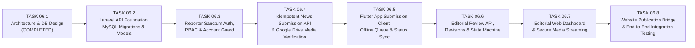

# Implementation Plan & Phased Roadmap (TASK 06.2 Onward)

> **Document Status:** Approved Phased Implementation Roadmap (TASK 06.1 — Design-Only)  
> **Important Constraint:** This document plans future tasks (**TASK 06.2 onward**). No backend code, database migrations, or Flutter code modifications were executed in TASK 06.1.

---

## 1. Phased Implementation Roadmap (TASK 06.2 – TASK 06.8)

To minimize risk and keep every milestone independently verifiable, backend and mobile integration work is broken into small, sequential tasks:

---

### TASK 06.2 — Laravel Backend Foundation, MySQL Migrations & Eloquent Models
- **Scope:**
  1. Create the 12 normalized MySQL migrations (`reporters`, `reporter_authentication`, `news`, `news_revisions`, `news_media`, `media_access_grants`, `editorial_reviews`, `editorial_comments`, `news_status_history`, `notifications`, `submission_idempotency_keys`, `audit_logs`) with all foreign keys, unique constraints, and composite indexes defined in `database_schema.md`.
  2. Implement Eloquent models, relationships, strict enum casts (`NewsStatusEnum`, `ReporterRoleEnum`, `MediaTypeEnum`), and immutable model guards on `NewsRevision`, `NewsStatusHistory`, and `AuditLog`.
  3. Create database seeders for test roles (`reporter`, `editor`, `senior_editor`, `admin`).
- **Independent Verification:**
  - `php artisan migrate:fresh --seed` succeeds cleanly on MySQL.
  - PHPUnit / Pest model & schema integrity tests verify FK constraints, unique UUID indexing, and immutability guards.

---

### TASK 06.3 — Reporter Authentication, Sanctum Tokens & Role-Based Authorization
- **Scope:**
  1. Implement `POST /api/v1/auth/login`, `POST /api/v1/auth/logout`, `GET /api/v1/reporter/profile`, and `PATCH /api/v1/reporter/google-account`.
  2. Implement `EnsureReporterIsActive` middleware (checks `status === 'active'`, `is_verified === true`, and revokes tokens immediately upon account suspension).
  3. Implement Laravel Policies (`NewsPolicy`, `EditorialReviewPolicy`) enforcing the RBAC & ownership matrix.
  4. Configure API rate limiters (`login`, `submissions`, `general`) and audit logging for login/logout/suspension events.
- **Independent Verification:**
  - Automated feature tests covering login, invalid password lockout, suspended reporter `403 ACCOUNT_SUSPENDED` rejection, token revocation, and role authorization checks.

---

### TASK 06.4 — Idempotent News Submission API & Google Drive Media Verification
- **Scope:**
  1. Implement `IdempotencyMiddleware` backed by `submission_idempotency_keys`.
  2. Implement `POST /api/v1/news/submissions` inside a single ACID database transaction (creating `news`, `news_revisions` #1, `news_media`, `media_access_grants`, `news_status_history`, and `audit_logs`).
  3. Implement `GoogleDriveMediaVerificationService` and `VerifySubmittedDriveMediaJob` using the Editorial Service Account to verify `drive_file_id` readability, MIME type, and file size.
  4. Implement `GET /api/v1/news`, `GET /api/v1/news/{uuid}`, and `GET /api/v1/news/{uuid}/status-history`.
- **Independent Verification:**
  - Feature tests verifying initial submission (`201 Created`), duplicate submission replay with same `Idempotency-Key` (`200 OK` without duplicate DB rows), payload mismatch (`409 IDEMPOTENCY_CONFLICT`), and Drive verification status updates.

---

### TASK 06.5 — Flutter App News Submission Integration & Offline Submission Queue
- **Scope:**
  1. Add Sanctum login/session management (`flutter_secure_storage`) to the Flutter app while keeping Google Drive OAuth (`google_sign_in`) strictly separate.
  2. Upgrade local SQLite schema in `LocalDatabaseService` to store `server_news_id`, `tracking_code`, `editorial_status`, `server_version`, `idempotency_key`, and `editorial_comments_json`.
  3. Wire the **Confirm Submission** action in `NewsPreviewScreen` to:
     - Grant `reader` permission on attached `drive_file_id`s to the `editorial_service_principal`.
     - Send `POST /api/v1/news/submissions` with deterministic `Idempotency-Key` (or queue offline if disconnected and auto-submit when connectivity returns).
  4. Lock submitted stories against local editing unless server status transitions to `correction_requested`.
  5. Display live server status badges (`Submitted`, `Under Review`, `Correction Requested`, `Approved`, `Published`) and editorial comments in the Flutter app.
- **Independent Verification:**
  - `flutter analyze`, `flutter test`, and live Android emulator (`emulator-5554`) end-to-end test confirming Drive sync never submits news, while explicit Confirm Submission sends the story to the Laravel API.

---

### TASK 06.6 — Editorial Workflow Engine, Revisions & Resubmission API
- **Scope:**
  1. Implement `EditorialWorkflowService` state machine enforcing all transition rules (`T1`–`T10`) and optimistic concurrency (`expected_version`).
  2. Implement editorial endpoints:
     - `GET /api/v1/editorial/news`
     - `POST /api/v1/editorial/news/{uuid}/claim`
     - `PATCH /api/v1/editorial/news/{uuid}/content` (creates immutable `editor_modification` revision)
     - `POST /api/v1/editorial/news/{uuid}/request-correction`
     - `POST /api/v1/editorial/news/{uuid}/reject`
     - `POST /api/v1/editorial/news/{uuid}/approve`
     - `GET /api/v1/news/{uuid}/revisions`
  3. Implement reporter resubmission endpoint `PUT /api/v1/news/{uuid}/resubmit` (creates `reporter_resubmission` revision).
- **Independent Verification:**
  - Feature tests verifying every valid and invalid state transition, optimistic lock `409 VERSION_CONFLICT`, immutable revision history numbering, and reporter resubmission flow.

---

### TASK 06.7 — Secure Editorial Media Streaming Proxy, Derivatives & Review UI
- **Scope:**
  1. Implement `GET /api/v1/editorial/media/{media_uuid}/stream` with HTTP Range support (`206 Partial Content`) proxying from the reporter's Google Drive via the Editorial Service Account.
  2. Implement `POST /api/v1/editorial/media/{media_uuid}/derivative` storing editor-modified media in Website-Controlled Storage (`EditorialStorage`).
  3. Build the Editorial Review Queue & Story Inspection UI for editors to preview text diffs, stream photos/videos/voice dispatches, leave section-targeted comments, and execute workflow actions.
- **Independent Verification:**
  - Feature and browser tests verifying unauthorized users cannot stream media, editors can play back voice/video dispatches, and editor derivatives are stored on website storage without modifying the reporter's Google Drive.

---

### TASK 06.8 — Website Publication Bridge & Full System Integration Testing
- **Scope:**
  1. Implement `POST /api/v1/editorial/news/{uuid}/publish` (`senior_editor` / `admin` only) to copy approved media into the public Website CDN storage and export the approved revision into the existing Laravel News Website's article tables.
  2. Implement push/in-app notification delivery (`/api/v1/notifications`).
  3. Run complete end-to-end integration tests across Flutter emulator -> Google Drive -> Laravel API -> Editorial Review -> Live Website Publication.

---

## 2. Unresolved Architectural Decisions & Risks

### 2.1 Open Decisions to Confirm Before TASK 06.2 / TASK 06.8
| # | Decision Topic | Recommended Default (Used in Design) | Alternative Option | Impact Area |
| :--- | :--- | :--- | :--- | :--- |
| **D1** | **Hosting Topology: Standalone API Service vs. Module Inside Existing Laravel Website** | Deploy the Editorial API & Review tables inside the **same Laravel application / MySQL server** (using dedicated tables or a separate schema prefix) so publishing to the public website is a fast local transaction. | Separate microservice & separate MySQL instance communicating via webhook/API. | TASK 06.2 & TASK 06.8 deployment configuration. |
| **D2** | **Google Cloud Service Account Provisioning** | Create one dedicated Google Cloud Service Account (`editorial-vault@<project>.iam.gserviceaccount.com`) in the same Google Cloud project that hosts the Android OAuth client ID. | Use a Google Workspace shared group (`editors@newsdesk.bd`) as the permission grantee. | TASK 06.4 & TASK 06.5 media permission grant config. |
| **D3** | **Editorial Storage Driver for Derivatives & Published Assets** | Use Laravel `Storage::disk('public')` for local/VPS deployments, configurable to `s3` / Cloudflare R2 via `.env` (`EDITORIAL_FILESYSTEM_DISK`). | Mandatory S3 bucket from day one. | TASK 06.7 & TASK 06.8 storage setup. |
| **D4** | **Reporter Account Provisioning Flow** | Admin-provisioned accounts only (Admins create `reporters` records and issue initial credentials; no public self-registration). | Self-registration with `pending_verification` approval queue. | TASK 06.3 auth endpoints. |

---

### 2.2 Technical Risks & Mitigations
| Risk | Severity | Mitigation Built into Architecture |
| :--- | :---: | :--- |
| **R1: Reporter deletes or unshares a file in personal Google Drive while story is `under_review`** | Medium | `VerifySubmittedDriveMediaJob` + on-demand check during review flags `upload_status = 'missing_on_drive'`, blocks transition to `approved`, and lets the editor return the story (`correction_requested`) so the reporter's app re-uploads from local storage. |
| **R2: Large video streaming latency from Google Drive during editorial review** | Low–Medium | `GET /api/v1/editorial/media/{uuid}/stream` supports HTTP `Range` requests (`206 Partial Content`) and caches active under-review media chunks in temporary server storage for 24 hours. |
| **R3: Duplicate submissions caused by flaky mobile data in rural field areas** | High | Solved via client-generated `client_draft_uuid` (`UNIQUE` on `news.uuid`) + deterministic `Idempotency-Key` persisted in `submission_idempotency_keys` (72h replay cache). |
| **R4: Reporter edits a draft locally at the exact moment a background submission retry succeeds** | Medium | Solved by locking the local draft (`submission_in_flight = 1`) as soon as **Confirm Submission** is tapped; edits are blocked unless the reporter explicitly cancels an unsent offline queue item or an editor returns the story to `correction_requested`. |

