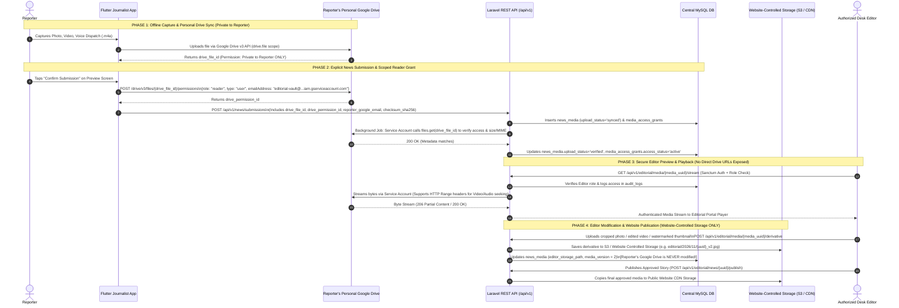

# Google Drive Media Architecture & Secure Editorial Access Strategy (TASK 06.1)

> **Document Status:** Approved Media Architecture & Security Specification (TASK 06.1 — Design-Only)  
> **Core Principle:** Original raw media (photos, videos, voice dispatches) remain in each reporter's personal Google Drive. Never assume a raw `drive_file_id` alone grants access, never make personal Drive files `anyoneWithLink` public, and never write editor-modified files back into a reporter's personal Google Drive.

---

## 1. Current Flutter Google Drive Architecture (TASK 01–05 Baseline)

In the completed Flutter Journalist App:
- Each reporter signs into their own personal Google account via `GoogleSignIn` using the least-privilege **`https://www.googleapis.com/auth/drive.file`** scope (plus `email` and `profile`).
- Raw media files are organized inside the reporter's personal Google Drive under:
  ```text
  My Drive/
  └── Journalist App Dispatches/          (Root App Folder)
      └── <Sanitized News Headline>/      (Per-Draft Subfolder: drive_folder_id)
          ├── photo_1731312000.jpg        (drive_file_id)
          ├── video_1731312055.mp4        (drive_file_id)
          ├── voice_1731312120.m4a        (drive_file_id)
          └── draft_<uuid>.json           (Backup metadata file: drive_File_id)
  ```
- Each attachment in local SQLite (`media_attachments`) tracks:
  `id` (`client_media_uuid`), `file_name`, `mime_type`, `file_size_bytes`, `duration_seconds`, `media_type`, `drive_file_id`, `drive_web_view_link`, `drive_download_link`, and `reporter_google_account_email`.

---

## 2. Why a Google Drive File ID Alone Does NOT Provide Editor Access

A Google Drive `fileId` (e.g., `1BxiMVs0XRA5nFMdKvBdBZjgmUUqptlbs74OgvE2upms`) is an **opaque resource identifier**, not an capability URL or access token:

1. **Private by Default:** Files uploaded via the Google Drive v3 API into a user's personal Drive default to **private ownership** (`owner = reporter@gmail.com`). Any HTTP request to `drive.google.com/file/d/{fileId}/view` or `googleapis.com/drive/v3/files/{fileId}?alt=media` from an editor's browser or the Laravel server will fail with **`403 Forbidden` / `404 Not Found`** unless explicit authorization exists.
2. **`drive.file` Scope Limitation:** The `drive.file` OAuth scope only allows the specific OAuth client app to access files **when authenticated as the user who created them**—or when the file has been explicitly shared via Drive Permissions with another Google identity.
3. **Prohibition on Public Links:** Making raw field dispatches publicly readable (`role: reader, type: anyone`) is a severe security and journalistic privacy violation (leaking unredacted raw footage, witness audio, or unpublished drafts if a link or file ID is guessed or leaked).

---

## 3. Evaluation of Candidate Editor Access Architectures

We evaluated three architectural patterns for enabling authorized newsroom editors to view, play back, and download original reporter media stored in personal Google Drives:

| Criteria | Option A: Public Link Sharing (`type: anyone`) | Option B: Backend Stores Reporter's Google OAuth Refresh Token | **Option C (RECOMMENDED): Scoped Service-Identity Permission Grant + Backend Authenticated Media Proxy + Editorial Vault Staging** |
| :--- | :--- | :--- | :--- |
| **How It Works** | App sets `anyoneWithLink` on Drive files upon upload/submit. | Flutter sends server auth code to Laravel; Laravel stores reporter's Google refresh token in MySQL. | On explicit **Confirm Submission**, the Flutter app (using the reporter's active `drive.file` token on the file it created) grants `role: reader, type: user` on the submitted `drive_file_id`s to a dedicated **Newsroom Editorial Service Account** (`editorial-vault@newsdesk.iam.gserviceaccount.com`). The Laravel backend authenticates as this Service Account to verify, stream, and cache media for editors. |
| **Privacy & Security** | **FAIL** — Anyone with the URL can access raw unverified media. | **HIGH RISK** — Central DB holds long-lived refresh tokens to every reporter's personal Google account; requires sensitive OAuth verification & client secrets. | **EXCELLENT** — Files remain strictly private in the reporter's Drive; only the specific submitted files are shared read-only with the newsroom's isolated service identity. Zero reporter Google refresh tokens stored in MySQL. |
| **Works When Reporter Is Offline After Submission?** | Yes | Yes (until token revoked) | **Yes** — Once the Drive permission grant is created at submission time, the Editorial Service Account can read the file 24/7 even if the reporter turns off their phone or their local OAuth access token expires. |
| **Survives Reporter Switching Google Accounts Later?** | Yes | Breaks if token overwritten | **Yes** — The Drive file permission (`drive_permission_id`) is attached to the file in Drive, independent of which account the reporter logs into later on their phone. |
| **No Google Client Secret in Flutter?** | Yes | Harder (requires `serverAuthCode` exchange) | **Yes** — Uses the existing mobile `drive.file` access token to call `POST /drive/v3/files/{fileId}/permissions` (`sendNotificationEmail=false`). |

---

## 4. Recommended Architecture (Option C): End-to-End Media Access Flow

### 4.1 Mermaid Media Lifecycle & Access Diagram



---

### 4.2 Detailed Breakdown of the Four Media Phases

#### Phase 1: Private Personal Upload (`Draft` State)
- While a story is a local `draft`, files uploaded to `Journalist App Dispatches/<News Title>/` have **no** external permissions granted. Only the reporter can see them.

#### Phase 2: Scoped Editorial Permission Grant on Explicit Submission
- When (and **only** when) the reporter explicitly taps **Confirm Submission**, the Flutter app iterates through the draft's attached `NewsMedia` items (`mediaAttachments` + `voiceDispatch`) and ensures each file (or the parent `<News Title>` folder) has a `reader` permission granted to the newsroom's dedicated Google Cloud Service Account (`editorial-vault@<project>.iam.gserviceaccount.com`):
  - **Drive API Call:** `POST https://www.googleapis.com/drive/v3/files/{driveFileId}/permissions?sendNotificationEmail=false`
  - **Body:** `{"role": "reader", "type": "user", "emailAddress": "editorial-vault@<project>.iam.gserviceaccount.com"}`
  - Because the file was created by the Flutter app under the `drive.file` scope, the app is fully authorized by Google Drive to manage permissions on that specific file without needing full `drive` scope.
- Upon receiving the submission payload, Laravel runs `VerifySubmittedDriveMediaJob`:
  - Using the Editorial Service Account's private key (stored securely in Laravel's server `.env` / secret manager, **never** in Flutter), the backend calls `files.get(fileId, fields="id,name,mimeType,size,md5Checksum,trashed")`.
  - Verifies that the file is not trashed, matches the declared `mime_type` and `file_size_bytes`, and updates `media_access_grants.access_status = 'active'` and `news_media.upload_status = 'verified'`.

#### Phase 3: Authenticated Backend Streaming Proxy for Editors
- Editors in the Editorial Review Portal **never** receive raw Google Drive links that require personal Google sign-in.
- Instead, the Editorial Portal loads media via authenticated Laravel endpoints:
  - `GET /api/v1/editorial/media/{media_uuid}/stream` (supports HTTP `Range: bytes=...` headers for smooth video and voice dispatch scrubbing).
  - `GET /api/v1/editorial/media/{media_uuid}/download` (for downloading raw footage to an editor's workstation).
- The Laravel endpoint checks:
  1. The caller is an authenticated `editor`, `senior_editor`, or `admin` (or the owning `reporter`).
  2. Writes an entry to `audit_logs` (`action = 'media.streamed'`).
  3. Streams the file from Google Drive using the Editorial Service Account (with optional encrypted short-term local disk/Redis chunk caching for frequently replayed videos during active review).

#### Phase 4: Editor-Modified Media & Website Publication Storage
- **Strict Rule:** Editors have `reader` (read-only) access to the reporter's Drive file. Even if an editor crops a photo, trims a video, normalizes voice audio, or generates a thumbnail, **editor-modified media is NEVER uploaded back into the reporter's personal Google Drive.**
- All editor-processed derivatives are stored in **Website-Controlled Media Storage** (`editor_storage_disk = 's3_editorial'`, `editor_storage_path = 'editorial/derivatives/...'`) while preserving the original `drive_file_id` pointer in `news_media` so the unedited original is always auditable.
- When a story transitions from `approved` to `published`:
  - The publishing pipeline copies the final approved media (either the editor's derivative if `editor_storage_path` is present, or a fresh copy pulled from the reporter's Drive via the Service Account) into the **Existing Laravel News Website's Public CDN Storage**.
  - **Why copy on publish?** Public website readers must never load images/videos from a reporter's personal Google Drive (which would fail under traffic spikes, violate privacy, and break if the reporter later deletes the file from their personal Drive).

---

## 5. Handling Edge Cases & Failure Modes

| Failure Scenario | Detection Mechanism | System Behavior & Recovery Workflow |
| :--- | :--- | :--- |
| **1. Reporter revokes permission or deletes file from personal Google Drive *after* submission (`submitted` / `under_review`)** | When the editor opens the story or `VerifySubmittedDriveMediaJob` runs, the Service Account receives `404 Not Found` or `403 Forbidden` (or `trashed == true`). | 1. `media_access_grants.access_status` is set to `'file_deleted'` or `'revoked_by_reporter'`, and `news_media.upload_status` becomes `'missing_on_drive'`.<br>2. The Editorial Portal displays a clear warning badge on that attachment.<br>3. Story **cannot** transition to `approved` while a required attachment is `missing_on_drive`.<br>4. The editor clicks **Request Correction** (`correction_requested`), which notifies the reporter in Flutter to re-upload/re-grant the missing attachment from their local device storage and resubmit. |
| **2. Reporter switches Google accounts on their phone** | Each `news_media` row stores `reporter_google_email` at the time of upload. | - For **already-submitted** stories: No impact, because the `drive_permission_id` grant to the Editorial Service Account lives on the Google Drive file itself.<br>- For **unsubmitted local drafts**: The Flutter app (implemented in TASK 04.4) isolates Drive sync by `reporterGoogleAccountEmail` and prevents cross-account file mixing. |
| **3. Reporter's local Google OAuth token expires while offline** | Flutter `GoogleSignIn.signInSilently()` refreshes the token automatically when back online, or prompts re-authentication before Drive upload can complete. | Local files remain safely stored in the app's local sandbox (`app_flutter/media_attachments/`) and SQLite (`pending` sync status) until the reporter refreshes Google sign-in. |
| **4. Reporter deletes file from Google Drive *after* the story is `published`** | None needed for live website readers. | Because Phase 4 copies the final approved media into **Website-Controlled Public CDN Storage** at the moment of `approved -> published`, the live article on the news website continues working indefinitely even if the reporter empties their personal Google Drive months later. |

---

## 6. Security, Privacy, Operational & Cost Trade-Offs

| Dimension | Impact & Justification |
| :--- | :--- |
| **Security & Least Privilege** | Neither the Flutter app nor the Laravel backend ever requests full `https://www.googleapis.com/auth/drive` access to a reporter's personal documents. The app only touches files it creates (`drive.file`), and the backend Service Account only sees files where the reporter explicitly pressed **Confirm Submission**. |
| **Journalistic Source Protection & Privacy** | Unsubmitted drafts and raw outtakes stay 100% private in the reporter's personal Drive and local device storage. Even for submitted stories, raw files are only streamable by authenticated editors (`role IN ('editor','senior_editor','admin')`) with every access logged in `audit_logs`. |
| **Storage Cost Efficiency** | The newsroom does **not** pay cloud storage costs for unsubmitted drafts, rejected stories, or massive raw multi-take video files—those reside in each reporter's free 15 GB personal Google Drive. Central newsroom storage (`EditorialStorage` / Website CDN) only stores editor-modified derivatives and final published assets. |
| **Operational Reliability** | Decoupling live website delivery (CDN) from personal Google Drive (raw archive) guarantees that high-traffic breaking news articles never hit Google Drive rate limits (`429 Too Many Requests`). |

